# AI-Powered Dynamic Customer Feedback & Brand Crisis Intelligence Platform
## Complete Implementation Plan — Phase 1

> **Platform codename:** `SignalStream`
> **Version:** 1.0.0
> **Date:** 2026-10-06

---

## Table of Contents

1. [Product Requirements](#1-product-requirements)
2. [Functional Requirements](#2-functional-requirements)
3. [Non-Functional Requirements](#3-non-functional-requirements)
4. [System Architecture](#4-system-architecture)
5. [Service Boundaries](#5-service-boundaries)
6. [Database Architecture](#6-database-architecture)
7. [Kafka Architecture](#7-kafka-architecture)
8. [Event Schemas](#8-event-schemas)
9. [API Contracts](#9-api-contracts)
10. [Authentication Architecture](#10-authentication-architecture)
11. [Authorization / RBAC Architecture](#11-authorization--rbac-architecture)
12. [Multi-Tenancy Strategy](#12-multi-tenancy-strategy)
13. [AI/ML Architecture](#13-aiml-architecture)
14. [LLM Architecture](#14-llm-architecture)
15. [Guardrail Architecture](#15-guardrail-architecture)
16. [MCP Architecture](#16-mcp-architecture)
17. [CrewAI Architecture](#17-crewai-architecture)
18. [Redis Architecture](#18-redis-architecture)
19. [Vector Search Architecture](#19-vector-search-architecture)
20. [Security Architecture](#20-security-architecture)
21. [Observability Architecture](#21-observability-architecture)
22. [Deployment Architecture](#22-deployment-architecture)
23. [CI/CD Architecture](#23-cicd-architecture)
24. [Testing Strategy](#24-testing-strategy)
25. [Disaster Recovery Strategy](#25-disaster-recovery-strategy)
26. [Backup Strategy](#26-backup-strategy)
27. [Scaling Strategy](#27-scaling-strategy)
28. [Cost Optimization Strategy](#28-cost-optimization-strategy)
29. [Development Phases](#29-development-phases)
30. [Production Deployment Plan](#30-production-deployment-plan)
31. [Internal Consistency Checks](#31-internal-consistency-checks)

---

## 1. Product Requirements

### 1.1 Vision

A multi-tenant SaaS platform that ingests customer feedback from heterogeneous sources, processes it through an event-driven AI pipeline, detects emerging problems, predicts customer risk, routes and auto-resolves support tickets, and delivers actionable business recommendations — all with strict tenant isolation, audit trails, and AI decision traceability.

### 1.2 Target Personas

| Persona | Needs |
|---|---|
| **C-Suite / VP** | High-level health, crisis risk, revenue-impacting signals, strategic recommendations |
| **Customer Support Manager** | Ticket queue, routing, SLA tracking, auto-resolution status, agent workload |
| **Product Manager** | Feature sentiment, defect trends, demand signals, product opportunities |
| **Marketing / Brand** | Brand sentiment, reputation trends, crisis early-warning |
| **Operations Lead** | Root causes, logistics issues, regional problems, partner performance |
| **Data / Platform Team** | Event throughput, Kafka lag, model metrics, LLM cost, data quality |

### 1.3 Business Questions Answered

- What are customers saying?
- How do customers feel?
- What problems are customers experiencing?
- Which problems are increasing?
- Where is the problem occurring (region, product, partner)?
- What is the likely root cause?
- Could this become a brand crisis?
- What products/features are failing?
- What are customers requesting?
- Which customers may churn?
- Which support tickets should be routed where?
- Which tickets can safely be automatically resolved?
- What should the company do next?

### 1.4 Key Differentiators

- **Event-driven, not batch**: Real-time streaming pipeline via Kafka
- **Multi-tenant by design**: Strict data isolation at every layer
- **AI-augmented, not AI-dependent**: Traditional ML + rules + LLM where reasoning is needed
- **Decision traceability**: Every AI decision is auditable
- **Cost-conscious AI**: Semantic caching, model routing, batch processing
- **Production-oriented**: Health checks, DLQ, retries, observability, Kubernetes-ready

---

## 2. Functional Requirements

### 2.1 Data Ingestion

| ID | Requirement |
|---|---|
| F-ING-01 | REST API ingestion with schema-flexible payloads |
| F-ING-02 | Webhook receiver for external system events |
| F-ING-03 | CSV/Excel bulk upload with async processing |
| F-ING-04 | Zendesk integration via OAuth + webhooks |
| F-ING-05 | Intercom integration via OAuth + webhooks |
| F-ING-06 | CRM integration framework (pluggable) |
| F-ING-07 | Idempotency-key support for deduplication |
| F-ING-08 | HTTP 202 Accepted for async processing |

### 2.2 Normalization

| ID | Requirement |
|---|---|
| F-NRM-01 | Schema detection and field mapping |
| F-NRM-02 | Type conversion and timestamp normalization |
| F-NRM-03 | Text cleaning (HTML, unicode, whitespace) |
| F-NRM-04 | PII detection and redaction |
| F-NRM-05 | Canonical event schema output |
| F-NRM-06 | Tenant metadata enrichment |

### 2.3 Intelligence Pipeline

| ID | Requirement |
|---|---|
| F-INT-01 | Sentiment & emotion analysis (positive/negative/neutral, joy/anger/frustration/etc.) |
| F-INT-02 | Complaint & issue classification (delivery, payment, refund, product defect, etc.) |
| F-INT-03 | Trend detection (velocity, emerging issues, sentiment shifts) |
| F-INT-04 | Brand crisis detection (composite score from multiple signals) |
| F-INT-05 | Root cause analysis (product × region × partner × time correlation) |
| F-INT-06 | Customer demand intelligence (feature requests, market gaps) |
| F-INT-07 | Product intelligence (feature sentiment, defects, strengths) |
| F-INT-08 | Support intelligence (resolution time, escalation, agent performance) |
| F-INT-09 | Churn risk scoring (complaint history, cancellation intent, sentiment) |
| F-INT-10 | Business recommendation generation |

### 2.4 Support Operations

| ID | Requirement |
|---|---|
| F-SUP-01 | JEV routing (department, queue, priority, SLA) |
| F-SUP-02 | Smart auto-resolution with confidence thresholds |
| F-SUP-03 | Draft response generation for human approval (75-95% confidence) |
| F-SUP-04 | Mandatory human handling for high-risk categories |
| F-SUP-05 | Ticket lifecycle tracking |
| F-SUP-06 | Escalation rules |

### 2.5 Dashboards

| ID | Requirement |
|---|---|
| F-DSH-01 | Executive dashboard |
| F-DSH-02 | Customer support dashboard |
| F-DSH-03 | Product dashboard |
| F-DSH-04 | Marketing/brand dashboard |
| F-DSH-05 | Operations dashboard |
| F-DSH-06 | Data/analytics dashboard |
| F-DSH-07 | Cross-dashboard drill-down |
| F-DSH-08 | AI decision explainability panels |

### 2.6 Administration

| ID | Requirement |
|---|---|
| F-ADM-01 | Company/tenant management |
| F-ADM-02 | User management with RBAC |
| F-ADM-03 | API key lifecycle management |
| F-ADM-04 | Integration configuration |
| F-ADM-05 | Webhook management |
| F-ADM-06 | Notification preferences |
| F-ADM-07 | Data retention configuration |

---

## 3. Non-Functional Requirements

| Category | Requirement | Target |
|---|---|---|
| **Availability** | Uptime SLA | 99.9% (API), 99.5% (workers) |
| **Latency** | API response (p95) | < 200ms (simple reads), < 500ms (analytics) |
| **Latency** | Ingestion to normalized event | < 5s (p95) |
| **Latency** | Normalized to intelligence results | < 30s (p95 per worker) |
| **Throughput** | Ingestion sustained | 10,000 events/sec per tenant |
| **Throughput** | Global sustained | 100,000 events/sec |
| **Scalability** | Tenants | 1,000+ |
| **Scalability** | Workers | Horizontal, per consumer group |
| **Security** | Tenant isolation | Strict logical isolation, tested |
| **Security** | Data at rest | AES-256 (database, S3) |
| **Security** | Data in transit | TLS 1.3 |
| **Compliance** | PII handling | Detection, redaction, configurable retention |
| **Observability** | Metrics | Prometheus, per-service |
| **Observability** | Logging | Structured JSON, correlation IDs |
| **Observability** | Tracing | OpenTelemetry spans |
| **Reliability** | Message delivery | At-least-once, idempotent consumers |
| **Reliability** | DLQ | All workers |
| **Maintainability** | Code coverage | > 80% (core), > 60% (workers) |

---

## 4. System Architecture

### 4.1 High-Level Architecture

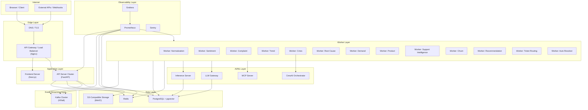

### 4.2 Data Flow

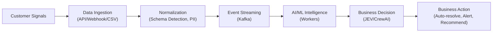

### 4.3 Worker Dependency Graph

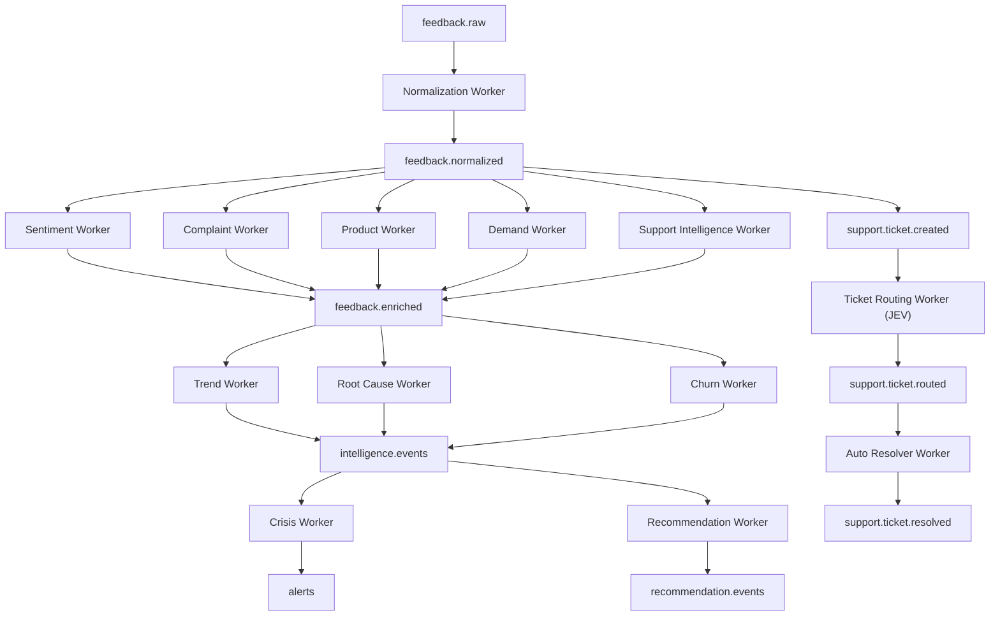

> [!IMPORTANT]
> Workers at the same level (Sentiment, Complaint, Product, Demand, Support) consume from the same topic (`feedback.normalized`) independently via separate consumer groups. They produce to a shared `feedback.enriched` topic. Downstream workers (Trend, Root Cause, Churn) wait for enriched events. Crisis and Recommendation are the final intelligence layer.

---

## 5. Service Boundaries

| Service | Technology | Deployment Unit | Port | Stateless? |
|---|---|---|---|---|
| **Frontend** | Next.js 14, TypeScript, Tailwind CSS | `frontend` | 3000 | Yes |
| **API Gateway** | Nginx | `gateway` | 80/443 | Yes |
| **API Server** | Python 3.12, FastAPI, SQLAlchemy, Alembic | `api` | 8000 | Yes |
| **Normalization Worker** | Python 3.12 | `worker-normalization` | — | Yes |
| **Sentiment Worker** | Python 3.12 | `worker-sentiment` | — | Yes |
| **Complaint Worker** | Python 3.12 | `worker-complaint` | — | Yes |
| **Trend Worker** | Python 3.12 | `worker-trend` | — | Yes |
| **Crisis Worker** | Python 3.12 | `worker-crisis` | — | Yes |
| **Root Cause Worker** | Python 3.12 | `worker-rootcause` | — | Yes |
| **Demand Worker** | Python 3.12 | `worker-demand` | — | Yes |
| **Product Worker** | Python 3.12 | `worker-product` | — | Yes |
| **Support Intel Worker** | Python 3.12 | `worker-support` | — | Yes |
| **Churn Worker** | Python 3.12 | `worker-churn` | — | Yes |
| **Recommendation Worker** | Python 3.12 | `worker-recommendation` | — | Yes |
| **Ticket Routing Worker** | Python 3.12 | `worker-ticket-routing` | — | Yes |
| **Auto Resolver Worker** | Python 3.12 | `worker-auto-resolver` | — | Yes |
| **Inference Server** | Python 3.12, FastAPI | `inference` | 8100 | Yes |
| **LLM Gateway** | Python 3.12 | (library, in-process) | — | — |
| **MCP Server** | Python 3.12 | `mcp-server` | 8200 | Yes |
| **PostgreSQL** | PostgreSQL 16 + pgvector | `postgres` | 5432 | No |
| **Redis** | Redis 7 | `redis` | 6379 | No |
| **Kafka** | Apache Kafka 3.7 (KRaft) | `kafka` | 9092 | No |
| **MinIO** | MinIO | `minio` | 9000 | No |
| **Prometheus** | Prometheus | `prometheus` | 9090 | No |
| **Grafana** | Grafana | `grafana` | 3001 | No |

> [!NOTE]
> The LLM Gateway is implemented as a shared Python library (`packages/llm-gateway`) consumed by workers in-process. It does not run as a separate HTTP service in v1. This avoids an extra network hop for every LLM call. If latency or scaling demands separate deployment in the future, the abstraction supports it.

---

## 6. Database Architecture

### 6.1 PostgreSQL Schema Overview

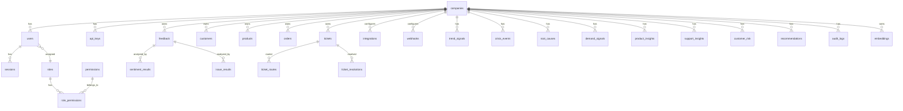

### 6.2 Core Tables

#### Tenant & Auth

```sql
-- companies: Root tenant entity
CREATE TABLE companies (
    id              UUID PRIMARY KEY DEFAULT gen_random_uuid(),
    name            VARCHAR(255) NOT NULL,
    slug            VARCHAR(100) NOT NULL UNIQUE,
    plan            VARCHAR(50) NOT NULL DEFAULT 'free',
    settings        JSONB NOT NULL DEFAULT '{}',
    created_at      TIMESTAMPTZ NOT NULL DEFAULT NOW(),
    updated_at      TIMESTAMPTZ NOT NULL DEFAULT NOW(),
    is_active       BOOLEAN NOT NULL DEFAULT TRUE
);

-- users: Human users belonging to a company
CREATE TABLE users (
    id              UUID PRIMARY KEY DEFAULT gen_random_uuid(),
    company_id      UUID NOT NULL REFERENCES companies(id),
    email           VARCHAR(320) NOT NULL,
    password_hash   VARCHAR(255) NOT NULL,
    full_name       VARCHAR(255) NOT NULL,
    role_id         UUID NOT NULL REFERENCES roles(id),
    is_active       BOOLEAN NOT NULL DEFAULT TRUE,
    email_verified  BOOLEAN NOT NULL DEFAULT FALSE,
    last_login_at   TIMESTAMPTZ,
    created_at      TIMESTAMPTZ NOT NULL DEFAULT NOW(),
    updated_at      TIMESTAMPTZ NOT NULL DEFAULT NOW(),
    UNIQUE(company_id, email)
);

-- roles: RBAC roles
CREATE TABLE roles (
    id              UUID PRIMARY KEY DEFAULT gen_random_uuid(),
    company_id      UUID REFERENCES companies(id),  -- NULL = system role
    name            VARCHAR(100) NOT NULL,
    description     TEXT,
    is_system       BOOLEAN NOT NULL DEFAULT FALSE,
    created_at      TIMESTAMPTZ NOT NULL DEFAULT NOW()
);

-- permissions: Granular permissions
CREATE TABLE permissions (
    id              UUID PRIMARY KEY DEFAULT gen_random_uuid(),
    codename        VARCHAR(100) NOT NULL UNIQUE,  -- e.g. 'feedback:read'
    description     TEXT
);

-- role_permissions: M2M
CREATE TABLE role_permissions (
    role_id         UUID NOT NULL REFERENCES roles(id) ON DELETE CASCADE,
    permission_id   UUID NOT NULL REFERENCES permissions(id) ON DELETE CASCADE,
    PRIMARY KEY (role_id, permission_id)
);

-- api_keys: Company API keys for programmatic access
CREATE TABLE api_keys (
    id              UUID PRIMARY KEY DEFAULT gen_random_uuid(),
    company_id      UUID NOT NULL REFERENCES companies(id),
    name            VARCHAR(255) NOT NULL,
    key_prefix      VARCHAR(12) NOT NULL,       -- e.g. 'ak_live_xxxx'
    key_hash        VARCHAR(255) NOT NULL,       -- argon2id hash
    scopes          TEXT[] NOT NULL DEFAULT '{}', -- e.g. {'feedback:write','tickets:read'}
    expires_at      TIMESTAMPTZ,
    last_used_at    TIMESTAMPTZ,
    is_active       BOOLEAN NOT NULL DEFAULT TRUE,
    created_by      UUID REFERENCES users(id),
    created_at      TIMESTAMPTZ NOT NULL DEFAULT NOW(),
    revoked_at      TIMESTAMPTZ
);

-- sessions: JWT refresh token tracking
CREATE TABLE sessions (
    id              UUID PRIMARY KEY DEFAULT gen_random_uuid(),
    user_id         UUID NOT NULL REFERENCES users(id) ON DELETE CASCADE,
    refresh_token_hash VARCHAR(255) NOT NULL,
    user_agent      TEXT,
    ip_address      INET,
    expires_at      TIMESTAMPTZ NOT NULL,
    revoked_at      TIMESTAMPTZ,
    created_at      TIMESTAMPTZ NOT NULL DEFAULT NOW()
);
```

#### Business Entities

```sql
-- customers: Customer records per tenant
CREATE TABLE customers (
    id              UUID PRIMARY KEY DEFAULT gen_random_uuid(),
    company_id      UUID NOT NULL REFERENCES companies(id),
    external_id     VARCHAR(255),
    email           VARCHAR(320),
    name            VARCHAR(255),
    tier            VARCHAR(50) DEFAULT 'standard',
    metadata        JSONB NOT NULL DEFAULT '{}',
    created_at      TIMESTAMPTZ NOT NULL DEFAULT NOW(),
    updated_at      TIMESTAMPTZ NOT NULL DEFAULT NOW(),
    UNIQUE(company_id, external_id)
);

-- products: Product catalog per tenant
CREATE TABLE products (
    id              UUID PRIMARY KEY DEFAULT gen_random_uuid(),
    company_id      UUID NOT NULL REFERENCES companies(id),
    external_id     VARCHAR(255),
    name            VARCHAR(255) NOT NULL,
    category        VARCHAR(255),
    metadata        JSONB NOT NULL DEFAULT '{}',
    created_at      TIMESTAMPTZ NOT NULL DEFAULT NOW(),
    UNIQUE(company_id, external_id)
);

-- orders: Order records
CREATE TABLE orders (
    id              UUID PRIMARY KEY DEFAULT gen_random_uuid(),
    company_id      UUID NOT NULL REFERENCES companies(id),
    external_id     VARCHAR(255),
    customer_id     UUID REFERENCES customers(id),
    product_ids     UUID[],
    status          VARCHAR(50),
    total_amount    DECIMAL(12,2),
    currency        VARCHAR(3) DEFAULT 'INR',
    metadata        JSONB NOT NULL DEFAULT '{}',
    created_at      TIMESTAMPTZ NOT NULL DEFAULT NOW(),
    UNIQUE(company_id, external_id)
);

-- feedback: Core feedback/signal records (partitioned by created_at)
CREATE TABLE feedback (
    id              UUID NOT NULL DEFAULT gen_random_uuid(),
    company_id      UUID NOT NULL REFERENCES companies(id),
    event_id        VARCHAR(100) NOT NULL UNIQUE,
    source          VARCHAR(50) NOT NULL,       -- 'api', 'zendesk', 'csv', etc.
    source_event_id VARCHAR(255),
    event_type      VARCHAR(100) NOT NULL,
    customer_id     UUID REFERENCES customers(id),
    product_id      UUID REFERENCES products(id),
    order_id        UUID REFERENCES orders(id),
    text            TEXT NOT NULL,
    text_clean      TEXT,
    region          VARCHAR(255),
    channel         VARCHAR(100),
    customer_tier   VARCHAR(50),
    metadata        JSONB NOT NULL DEFAULT '{}',
    pii_detected    BOOLEAN NOT NULL DEFAULT FALSE,
    pii_redacted    BOOLEAN NOT NULL DEFAULT FALSE,
    schema_version  VARCHAR(10) NOT NULL DEFAULT '1.0',
    processing_status VARCHAR(30) NOT NULL DEFAULT 'pending',
    idempotency_key VARCHAR(255),
    created_at      TIMESTAMPTZ NOT NULL DEFAULT NOW(),
    PRIMARY KEY (id, created_at)
) PARTITION BY RANGE (created_at);

-- tickets: Support tickets
CREATE TABLE tickets (
    id              UUID PRIMARY KEY DEFAULT gen_random_uuid(),
    company_id      UUID NOT NULL REFERENCES companies(id),
    feedback_id     UUID,
    external_id     VARCHAR(255),
    subject         VARCHAR(500),
    description     TEXT,
    status          VARCHAR(50) NOT NULL DEFAULT 'open',
    priority        VARCHAR(10),
    category        VARCHAR(100),
    customer_id     UUID REFERENCES customers(id),
    assigned_team   VARCHAR(255),
    assigned_agent  UUID REFERENCES users(id),
    sla_deadline    TIMESTAMPTZ,
    resolution_type VARCHAR(50),   -- 'auto', 'human', 'escalated'
    resolved_at     TIMESTAMPTZ,
    metadata        JSONB NOT NULL DEFAULT '{}',
    created_at      TIMESTAMPTZ NOT NULL DEFAULT NOW(),
    updated_at      TIMESTAMPTZ NOT NULL DEFAULT NOW()
);
```

#### Intelligence Results

```sql
-- sentiment_results
CREATE TABLE sentiment_results (
    id              UUID PRIMARY KEY DEFAULT gen_random_uuid(),
    company_id      UUID NOT NULL REFERENCES companies(id),
    feedback_id     UUID NOT NULL,
    sentiment       VARCHAR(20) NOT NULL,   -- positive, negative, neutral, mixed
    emotion         VARCHAR(30),            -- anger, frustration, joy, etc.
    confidence      FLOAT NOT NULL,
    severity        INTEGER,                -- 1-5
    model_id        VARCHAR(100),
    model_version   VARCHAR(50),
    created_at      TIMESTAMPTZ NOT NULL DEFAULT NOW()
);

-- issue_results
CREATE TABLE issue_results (
    id              UUID PRIMARY KEY DEFAULT gen_random_uuid(),
    company_id      UUID NOT NULL REFERENCES companies(id),
    feedback_id     UUID NOT NULL,
    issue_type      VARCHAR(100) NOT NULL,
    sub_type        VARCHAR(100),
    confidence      FLOAT NOT NULL,
    severity        INTEGER,
    model_id        VARCHAR(100),
    created_at      TIMESTAMPTZ NOT NULL DEFAULT NOW()
);

-- trend_signals
CREATE TABLE trend_signals (
    id              UUID PRIMARY KEY DEFAULT gen_random_uuid(),
    company_id      UUID NOT NULL REFERENCES companies(id),
    signal_type     VARCHAR(100) NOT NULL,   -- volume_spike, sentiment_shift, etc.
    dimension       VARCHAR(100),            -- product, region, issue_type
    dimension_value VARCHAR(255),
    current_value   FLOAT,
    baseline_value  FLOAT,
    deviation       FLOAT,
    window_start    TIMESTAMPTZ NOT NULL,
    window_end      TIMESTAMPTZ NOT NULL,
    severity        INTEGER,
    metadata        JSONB NOT NULL DEFAULT '{}',
    created_at      TIMESTAMPTZ NOT NULL DEFAULT NOW()
);

-- crisis_events
CREATE TABLE crisis_events (
    id              UUID PRIMARY KEY DEFAULT gen_random_uuid(),
    company_id      UUID NOT NULL REFERENCES companies(id),
    crisis_score    FLOAT NOT NULL,          -- 0-100
    risk_level      VARCHAR(20) NOT NULL,    -- low, medium, high, critical
    affected_products UUID[],
    affected_regions TEXT[],
    contributing_signals UUID[],             -- refs to trend_signals
    reason          TEXT,
    status          VARCHAR(30) NOT NULL DEFAULT 'active',
    acknowledged_by UUID REFERENCES users(id),
    resolved_at     TIMESTAMPTZ,
    created_at      TIMESTAMPTZ NOT NULL DEFAULT NOW()
);

-- root_causes
CREATE TABLE root_causes (
    id              UUID PRIMARY KEY DEFAULT gen_random_uuid(),
    company_id      UUID NOT NULL REFERENCES companies(id),
    issue_type      VARCHAR(100) NOT NULL,
    root_cause      TEXT NOT NULL,
    confidence      FLOAT NOT NULL,
    contributing_factors JSONB NOT NULL DEFAULT '[]',
    affected_entity_type VARCHAR(50),       -- product, warehouse, partner, region
    affected_entity_id VARCHAR(255),
    sample_feedback_ids UUID[],
    window_start    TIMESTAMPTZ,
    window_end      TIMESTAMPTZ,
    model_id        VARCHAR(100),
    created_at      TIMESTAMPTZ NOT NULL DEFAULT NOW()
);

-- demand_signals
CREATE TABLE demand_signals (
    id              UUID PRIMARY KEY DEFAULT gen_random_uuid(),
    company_id      UUID NOT NULL REFERENCES companies(id),
    signal_type     VARCHAR(100) NOT NULL,  -- feature_request, service_gap, pricing
    description     TEXT NOT NULL,
    frequency       INTEGER NOT NULL DEFAULT 1,
    sample_feedback_ids UUID[],
    metadata        JSONB NOT NULL DEFAULT '{}',
    created_at      TIMESTAMPTZ NOT NULL DEFAULT NOW()
);

-- product_insights
CREATE TABLE product_insights (
    id              UUID PRIMARY KEY DEFAULT gen_random_uuid(),
    company_id      UUID NOT NULL REFERENCES companies(id),
    product_id      UUID REFERENCES products(id),
    insight_type    VARCHAR(100) NOT NULL,  -- defect, strength, weakness, feature_request
    description     TEXT NOT NULL,
    sentiment_score FLOAT,
    frequency       INTEGER NOT NULL DEFAULT 1,
    sample_feedback_ids UUID[],
    created_at      TIMESTAMPTZ NOT NULL DEFAULT NOW()
);

-- support_insights
CREATE TABLE support_insights (
    id              UUID PRIMARY KEY DEFAULT gen_random_uuid(),
    company_id      UUID NOT NULL REFERENCES companies(id),
    metric_type     VARCHAR(100) NOT NULL,
    dimension       VARCHAR(100),
    dimension_value VARCHAR(255),
    value           FLOAT NOT NULL,
    window_start    TIMESTAMPTZ,
    window_end      TIMESTAMPTZ,
    metadata        JSONB NOT NULL DEFAULT '{}',
    created_at      TIMESTAMPTZ NOT NULL DEFAULT NOW()
);

-- customer_risk
CREATE TABLE customer_risk (
    id              UUID PRIMARY KEY DEFAULT gen_random_uuid(),
    company_id      UUID NOT NULL REFERENCES companies(id),
    customer_id     UUID NOT NULL REFERENCES customers(id),
    churn_score     FLOAT NOT NULL,         -- 0-1
    risk_level      VARCHAR(20) NOT NULL,
    reasons         JSONB NOT NULL DEFAULT '[]',
    contributing_feedback_ids UUID[],
    model_id        VARCHAR(100),
    created_at      TIMESTAMPTZ NOT NULL DEFAULT NOW()
);

-- recommendations
CREATE TABLE recommendations (
    id              UUID PRIMARY KEY DEFAULT gen_random_uuid(),
    company_id      UUID NOT NULL REFERENCES companies(id),
    category        VARCHAR(100) NOT NULL,
    recommended_action TEXT NOT NULL,
    priority        VARCHAR(10) NOT NULL,    -- P1, P2, P3, P4
    reason          TEXT,
    expected_impact TEXT,
    confidence      FLOAT,
    source_signals  UUID[],                  -- trend, crisis, root_cause IDs
    status          VARCHAR(30) NOT NULL DEFAULT 'pending',
    acknowledged_by UUID REFERENCES users(id),
    created_at      TIMESTAMPTZ NOT NULL DEFAULT NOW()
);
```

#### Ticket Routing & Resolution

```sql
-- ticket_routes
CREATE TABLE ticket_routes (
    id              UUID PRIMARY KEY DEFAULT gen_random_uuid(),
    company_id      UUID NOT NULL REFERENCES companies(id),
    ticket_id       UUID NOT NULL REFERENCES tickets(id),
    department      VARCHAR(100) NOT NULL,
    queue           VARCHAR(100),
    priority        VARCHAR(10) NOT NULL,
    sla_minutes     INTEGER,
    escalation_level INTEGER NOT NULL DEFAULT 0,
    routing_reason  TEXT,
    routing_model   VARCHAR(100),
    confidence      FLOAT,
    created_at      TIMESTAMPTZ NOT NULL DEFAULT NOW()
);

-- ticket_resolutions
CREATE TABLE ticket_resolutions (
    id              UUID PRIMARY KEY DEFAULT gen_random_uuid(),
    company_id      UUID NOT NULL REFERENCES companies(id),
    ticket_id       UUID NOT NULL REFERENCES tickets(id),
    resolution_type VARCHAR(50) NOT NULL,    -- auto, draft, human
    response_text   TEXT,
    confidence      FLOAT,
    policy_matched  VARCHAR(255),
    approved_by     UUID REFERENCES users(id),
    model_id        VARCHAR(100),
    tools_used      TEXT[],
    created_at      TIMESTAMPTZ NOT NULL DEFAULT NOW()
);
```

#### Embeddings & Knowledge

```sql
-- embeddings (pgvector)
CREATE TABLE embeddings (
    id              UUID PRIMARY KEY DEFAULT gen_random_uuid(),
    company_id      UUID NOT NULL REFERENCES companies(id),
    source_type     VARCHAR(50) NOT NULL,    -- feedback, knowledge, ticket
    source_id       UUID NOT NULL,
    embedding       vector(384) NOT NULL,    -- dimension matches model
    text_preview    TEXT,
    metadata        JSONB NOT NULL DEFAULT '{}',
    created_at      TIMESTAMPTZ NOT NULL DEFAULT NOW()
);

CREATE INDEX idx_embeddings_company_vector ON embeddings
    USING ivfflat (embedding vector_cosine_ops) WITH (lists = 100);

-- knowledge_documents
CREATE TABLE knowledge_documents (
    id              UUID PRIMARY KEY DEFAULT gen_random_uuid(),
    company_id      UUID NOT NULL REFERENCES companies(id),
    title           VARCHAR(500) NOT NULL,
    content         TEXT NOT NULL,
    category        VARCHAR(100),
    tags            TEXT[],
    is_active       BOOLEAN NOT NULL DEFAULT TRUE,
    created_at      TIMESTAMPTZ NOT NULL DEFAULT NOW(),
    updated_at      TIMESTAMPTZ NOT NULL DEFAULT NOW()
);
```

#### Operational

```sql
-- integrations
CREATE TABLE integrations (
    id              UUID PRIMARY KEY DEFAULT gen_random_uuid(),
    company_id      UUID NOT NULL REFERENCES companies(id),
    provider        VARCHAR(100) NOT NULL,   -- zendesk, intercom, slack
    config          JSONB NOT NULL DEFAULT '{}', -- encrypted credentials
    status          VARCHAR(30) NOT NULL DEFAULT 'inactive',
    last_sync_at    TIMESTAMPTZ,
    created_at      TIMESTAMPTZ NOT NULL DEFAULT NOW(),
    updated_at      TIMESTAMPTZ NOT NULL DEFAULT NOW()
);

-- webhooks
CREATE TABLE webhooks (
    id              UUID PRIMARY KEY DEFAULT gen_random_uuid(),
    company_id      UUID NOT NULL REFERENCES companies(id),
    url             TEXT NOT NULL,
    events          TEXT[] NOT NULL,          -- event types to subscribe
    secret_hash     VARCHAR(255),
    is_active       BOOLEAN NOT NULL DEFAULT TRUE,
    last_triggered  TIMESTAMPTZ,
    failure_count   INTEGER NOT NULL DEFAULT 0,
    created_at      TIMESTAMPTZ NOT NULL DEFAULT NOW()
);

-- audit_logs
CREATE TABLE audit_logs (
    id              UUID PRIMARY KEY DEFAULT gen_random_uuid(),
    company_id      UUID NOT NULL REFERENCES companies(id),
    actor_id        UUID,
    actor_type      VARCHAR(20) NOT NULL,    -- user, api_key, system
    action          VARCHAR(100) NOT NULL,
    resource_type   VARCHAR(100),
    resource_id     UUID,
    details         JSONB NOT NULL DEFAULT '{}',
    ip_address      INET,
    created_at      TIMESTAMPTZ NOT NULL DEFAULT NOW()
);

-- notifications
CREATE TABLE notifications (
    id              UUID PRIMARY KEY DEFAULT gen_random_uuid(),
    company_id      UUID NOT NULL REFERENCES companies(id),
    user_id         UUID REFERENCES users(id),
    type            VARCHAR(100) NOT NULL,
    title           VARCHAR(500) NOT NULL,
    message         TEXT,
    severity        VARCHAR(20),
    is_read         BOOLEAN NOT NULL DEFAULT FALSE,
    metadata        JSONB NOT NULL DEFAULT '{}',
    created_at      TIMESTAMPTZ NOT NULL DEFAULT NOW()
);

-- ai_decisions: Traceability for every important AI action
CREATE TABLE ai_decisions (
    id              UUID PRIMARY KEY DEFAULT gen_random_uuid(),
    company_id      UUID NOT NULL REFERENCES companies(id),
    decision_type   VARCHAR(100) NOT NULL,
    input_reference UUID,
    model_id        VARCHAR(100),
    model_version   VARCHAR(50),
    prompt_version  VARCHAR(50),
    confidence      FLOAT,
    reason          TEXT,
    output          JSONB NOT NULL,
    tools_used      TEXT[],
    human_approval  VARCHAR(30),             -- required, approved, rejected, none
    final_action    TEXT,
    tokens_used     INTEGER,
    latency_ms      INTEGER,
    created_at      TIMESTAMPTZ NOT NULL DEFAULT NOW()
);

-- model_versions
CREATE TABLE model_versions (
    id              UUID PRIMARY KEY DEFAULT gen_random_uuid(),
    model_name      VARCHAR(100) NOT NULL,
    version         VARCHAR(50) NOT NULL,
    model_type      VARCHAR(50) NOT NULL,    -- sentiment, embedding, classifier
    config          JSONB NOT NULL DEFAULT '{}',
    is_active       BOOLEAN NOT NULL DEFAULT TRUE,
    deployed_at     TIMESTAMPTZ NOT NULL DEFAULT NOW(),
    UNIQUE(model_name, version)
);

-- llm_usage: Cost tracking
CREATE TABLE llm_usage (
    id              UUID PRIMARY KEY DEFAULT gen_random_uuid(),
    company_id      UUID NOT NULL REFERENCES companies(id),
    provider        VARCHAR(50) NOT NULL,
    model           VARCHAR(100) NOT NULL,
    input_tokens    INTEGER NOT NULL,
    output_tokens   INTEGER NOT NULL,
    cost_usd        DECIMAL(10,6),
    latency_ms      INTEGER,
    purpose         VARCHAR(100),
    created_at      TIMESTAMPTZ NOT NULL DEFAULT NOW()
);

-- processing_jobs
CREATE TABLE processing_jobs (
    id              UUID PRIMARY KEY DEFAULT gen_random_uuid(),
    company_id      UUID NOT NULL REFERENCES companies(id),
    job_type        VARCHAR(100) NOT NULL,   -- csv_import, bulk_analysis
    status          VARCHAR(30) NOT NULL DEFAULT 'pending',
    total_items     INTEGER,
    processed_items INTEGER DEFAULT 0,
    failed_items    INTEGER DEFAULT 0,
    error_message   TEXT,
    file_path       TEXT,
    started_at      TIMESTAMPTZ,
    completed_at    TIMESTAMPTZ,
    created_at      TIMESTAMPTZ NOT NULL DEFAULT NOW()
);
```

### 6.3 Indexing Strategy

```sql
-- Tenant isolation indexes (on every tenant-owned table)
CREATE INDEX idx_feedback_company ON feedback(company_id, created_at DESC);
CREATE INDEX idx_tickets_company ON tickets(company_id, status, created_at DESC);
CREATE INDEX idx_sentiment_company ON sentiment_results(company_id, created_at DESC);
CREATE INDEX idx_customers_company ON customers(company_id);
CREATE INDEX idx_audit_company ON audit_logs(company_id, created_at DESC);

-- Lookup indexes
CREATE INDEX idx_feedback_event_id ON feedback(event_id);
CREATE INDEX idx_feedback_idempotency ON feedback(idempotency_key) WHERE idempotency_key IS NOT NULL;
CREATE INDEX idx_api_keys_prefix ON api_keys(key_prefix) WHERE is_active = TRUE;
CREATE INDEX idx_users_email ON users(company_id, email);
CREATE INDEX idx_tickets_status ON tickets(company_id, status);

-- Vector index
CREATE INDEX idx_embeddings_company_vector ON embeddings
    USING ivfflat (embedding vector_cosine_ops) WITH (lists = 100);
```

### 6.4 Partitioning

The `feedback` table is range-partitioned by `created_at` (monthly). Partitions are auto-created via `pg_partman` or an Alembic migration hook.

```sql
CREATE TABLE feedback_y2026m10 PARTITION OF feedback
    FOR VALUES FROM ('2026-10-01') TO ('2026-11-01');
CREATE TABLE feedback_y2026m11 PARTITION OF feedback
    FOR VALUES FROM ('2026-11-01') TO ('2026-12-01');
-- ... auto-created by partition management
```

---

## 7. Kafka Architecture

### 7.1 Cluster Configuration

| Setting | Value | Rationale |
|---|---|---|
| Mode | KRaft (no ZooKeeper) | Simplified deployment |
| Brokers (dev) | 1 | Local development |
| Brokers (prod) | 3 | Fault tolerance |
| Default replication factor (prod) | 3 | Data durability |
| Min in-sync replicas (prod) | 2 | Write safety |
| Compression | lz4 | CPU/size balance |

### 7.2 Topics

| Topic | Partitions | Retention | Key | Purpose |
|---|---|---|---|---|
| `feedback.raw` | 12 | 7d | `company_id` | Raw ingested events |
| `feedback.normalized` | 12 | 7d | `company_id` | Normalized canonical events |
| `feedback.enriched` | 12 | 7d | `company_id` | Events with sentiment/issue/product annotations |
| `sentiment.events` | 6 | 7d | `company_id` | Sentiment analysis results |
| `issue.events` | 6 | 7d | `company_id` | Complaint/issue detection results |
| `trend.events` | 6 | 14d | `company_id` | Trend signals |
| `crisis.events` | 3 | 30d | `company_id` | Crisis alerts |
| `rootcause.events` | 6 | 14d | `company_id` | Root cause analysis results |
| `demand.events` | 6 | 14d | `company_id` | Demand signals |
| `product.events` | 6 | 14d | `company_id` | Product intelligence |
| `support.events` | 6 | 14d | `company_id` | Support intelligence |
| `customer-risk.events` | 6 | 14d | `company_id` | Churn risk scores |
| `recommendation.events` | 6 | 30d | `company_id` | Business recommendations |
| `support.ticket.created` | 6 | 7d | `company_id` | New tickets |
| `support.ticket.analyzed` | 6 | 7d | `company_id` | Analyzed tickets |
| `support.ticket.routed` | 6 | 7d | `company_id` | Routed tickets |
| `support.ticket.resolved` | 6 | 30d | `company_id` | Resolved tickets |
| `alerts` | 3 | 30d | `company_id` | Notifications & alerts |
| `dlq.feedback.raw` | 3 | 30d | — | DLQ for raw feedback |
| `dlq.feedback.normalized` | 3 | 30d | — | DLQ for normalization failures |
| `dlq.intelligence` | 3 | 30d | — | DLQ for worker failures |
| `retry.feedback.normalized` | 6 | 3d | `company_id` | Retry queue |
| `retry.intelligence` | 6 | 3d | `company_id` | Retry queue |

### 7.3 Consumer Groups

| Consumer Group | Subscribes To | Instances (prod) |
|---|---|---|
| `cg-normalization` | `feedback.raw` | 3 |
| `cg-sentiment` | `feedback.normalized` | 3 |
| `cg-complaint` | `feedback.normalized` | 3 |
| `cg-product` | `feedback.normalized` | 2 |
| `cg-demand` | `feedback.normalized` | 2 |
| `cg-support` | `feedback.normalized` | 2 |
| `cg-trend` | `feedback.enriched` | 2 |
| `cg-rootcause` | `feedback.enriched` | 2 |
| `cg-churn` | `feedback.enriched` | 2 |
| `cg-crisis` | `intelligence.events` | 2 |
| `cg-recommendation` | `intelligence.events` | 2 |
| `cg-ticket-routing` | `support.ticket.created` | 3 |
| `cg-auto-resolver` | `support.ticket.routed` | 2 |

### 7.4 Producer Configuration

```python
PRODUCER_CONFIG = {
    "acks": "all",
    "enable_idempotence": True,
    "max_in_flight_requests_per_connection": 5,
    "retries": 3,
    "compression_type": "lz4",
    "linger_ms": 10,
    "batch_size": 32768,
}
```

### 7.5 Consumer Configuration

```python
CONSUMER_CONFIG = {
    "auto_offset_reset": "earliest",
    "enable_auto_commit": False,      # Manual commit after processing
    "max_poll_records": 100,
    "session_timeout_ms": 30000,
    "heartbeat_interval_ms": 10000,
}
```

### 7.6 Retry & DLQ Flow

```
Message fails processing
    ↓
Retry 1 (delay: 1s)
    ↓
Retry 2 (delay: 5s)
    ↓
Retry 3 (delay: 30s)
    ↓
Send to DLQ topic
    ↓
Log structured error with event_id, company_id, error
```

---

## 8. Event Schemas

### 8.1 Canonical Feedback Event (feedback.normalized)

```json
{
  "event_id": "EVT-a1b2c3d4",
  "company_id": "COMP-001",
  "source": "api",
  "source_event_id": null,
  "event_type": "customer.feedback.created",
  "timestamp": "2026-10-06T10:30:00Z",
  "customer_id": "CUST-123",
  "text": "My order was delayed by 5 days and customer support was unhelpful",
  "product_id": "PROD-500",
  "order_id": "ORD-900",
  "region": "Kolkata",
  "channel": "api",
  "customer_tier": "premium",
  "metadata": {
    "original_fields": {"message": "...", "product": "P500"}
  },
  "pii_redacted": true,
  "schema_version": "1.0",
  "correlation_id": "corr-x1y2z3",
  "trace_id": "trace-abc123"
}
```

### 8.2 Sentiment Event

```json
{
  "event_id": "SENT-e5f6g7h8",
  "company_id": "COMP-001",
  "feedback_id": "EVT-a1b2c3d4",
  "sentiment": "negative",
  "emotion": "frustration",
  "confidence": 0.94,
  "severity": 4,
  "model_id": "sentiment-v2",
  "model_version": "2.1.0",
  "timestamp": "2026-10-06T10:30:05Z",
  "correlation_id": "corr-x1y2z3"
}
```

### 8.3 Issue Event

```json
{
  "event_id": "ISS-i9j0k1l2",
  "company_id": "COMP-001",
  "feedback_id": "EVT-a1b2c3d4",
  "issue_type": "delivery_delay",
  "sub_type": "late_delivery",
  "confidence": 0.91,
  "severity": 4,
  "model_id": "issue-classifier-v1",
  "timestamp": "2026-10-06T10:30:06Z",
  "correlation_id": "corr-x1y2z3"
}
```

### 8.4 Crisis Event

```json
{
  "event_id": "CRI-m3n4o5p6",
  "company_id": "COMP-001",
  "crisis_score": 86.0,
  "risk_level": "critical",
  "affected_products": ["PROD-500"],
  "affected_regions": ["Kolkata"],
  "contributing_signals": ["TREND-001", "TREND-002"],
  "reason": "Delivery delay complaints increased 7x in 24h in Kolkata region",
  "recommended_actions": [
    "Investigate Delivery Partner Y in Kolkata",
    "Notify affected premium customers",
    "Escalate to logistics team"
  ],
  "timestamp": "2026-10-06T10:35:00Z",
  "correlation_id": "corr-x1y2z3"
}
```

### 8.5 Envelope Format

Every Kafka message uses a standard envelope:

```json
{
  "schema_version": "1.0",
  "event_id": "...",
  "event_type": "sentiment.analyzed",
  "company_id": "...",
  "correlation_id": "...",
  "trace_id": "...",
  "timestamp": "...",
  "producer": "worker-sentiment",
  "payload": { }
}
```

---

## 9. API Contracts

### 9.1 Authentication

```
POST   /api/v1/auth/login          → { access_token, refresh_token, user }
POST   /api/v1/auth/refresh        → { access_token }
POST   /api/v1/auth/logout         → 204
POST   /api/v1/auth/password-reset → 202
POST   /api/v1/auth/verify-email   → 200
```

### 9.2 Company Management

```
GET    /api/v1/companies/me                → Company profile
PATCH  /api/v1/companies/me                → Update settings
GET    /api/v1/companies/me/users          → List users
POST   /api/v1/companies/me/users          → Create user
PATCH  /api/v1/companies/me/users/:id      → Update user
DELETE /api/v1/companies/me/users/:id      → Deactivate user
```

### 9.3 API Keys

```
GET    /api/v1/api-keys           → List API keys (metadata only)
POST   /api/v1/api-keys           → Create key → { key_prefix, secret } (shown ONCE)
DELETE /api/v1/api-keys/:id       → Revoke
PATCH  /api/v1/api-keys/:id       → Update (name, scopes, expiration)
```

### 9.4 Feedback Ingestion

```
POST   /api/v1/feedback            → 202 Accepted { event_id, status: "queued" }
POST   /api/v1/feedback/bulk       → 202 Accepted { job_id, total_items }
POST   /api/v1/feedback/upload     → 202 Accepted { job_id } (CSV/Excel)
GET    /api/v1/feedback             → Paginated list (tenant-scoped)
GET    /api/v1/feedback/:id        → Detail with intelligence results
GET    /api/v1/feedback/jobs/:id   → Job status
```

Headers:
```
Authorization: Bearer <jwt> | Bearer <api_key>
Idempotency-Key: <optional>
Content-Type: application/json | multipart/form-data
```

### 9.5 Tickets

```
GET    /api/v1/tickets              → Paginated, filterable
GET    /api/v1/tickets/:id          → Detail with routing & resolution
PATCH  /api/v1/tickets/:id          → Update status, assign
POST   /api/v1/tickets/:id/approve  → Approve auto-resolution draft
POST   /api/v1/tickets/:id/reject   → Reject auto-resolution
```

### 9.6 Analytics & Intelligence

```
GET    /api/v1/analytics/overview          → Executive metrics
GET    /api/v1/analytics/sentiment         → Sentiment trends
GET    /api/v1/analytics/issues            → Issue breakdown
GET    /api/v1/analytics/trends            → Trend signals
GET    /api/v1/analytics/crisis            → Crisis status
GET    /api/v1/analytics/rootcauses        → Root cause analysis
GET    /api/v1/analytics/demand            → Demand signals
GET    /api/v1/analytics/products          → Product insights
GET    /api/v1/analytics/support           → Support metrics
GET    /api/v1/analytics/churn             → At-risk customers
GET    /api/v1/analytics/recommendations   → Business recommendations
```

Query parameters: `?from=&to=&product_id=&region=&channel=&page=&limit=`

### 9.7 Integrations

```
GET    /api/v1/integrations         → List
POST   /api/v1/integrations         → Configure
PATCH  /api/v1/integrations/:id     → Update
DELETE /api/v1/integrations/:id     → Remove
POST   /api/v1/integrations/:id/test → Test connection
```

### 9.8 Webhooks (Outbound)

```
GET    /api/v1/webhooks             → List
POST   /api/v1/webhooks             → Create
PATCH  /api/v1/webhooks/:id         → Update
DELETE /api/v1/webhooks/:id         → Delete
```

### 9.9 Webhook Receiver (Inbound)

```
POST   /api/v1/webhooks/receive/zendesk   → 200
POST   /api/v1/webhooks/receive/intercom  → 200
POST   /api/v1/webhooks/receive/:provider → 200
```

### 9.10 Health

```
GET    /health          → { status: "ok", version, uptime }
GET    /ready           → { ready: true, checks: { db, redis, kafka } }
```

---

## 10. Authentication Architecture

### 10.1 Human Authentication Flow

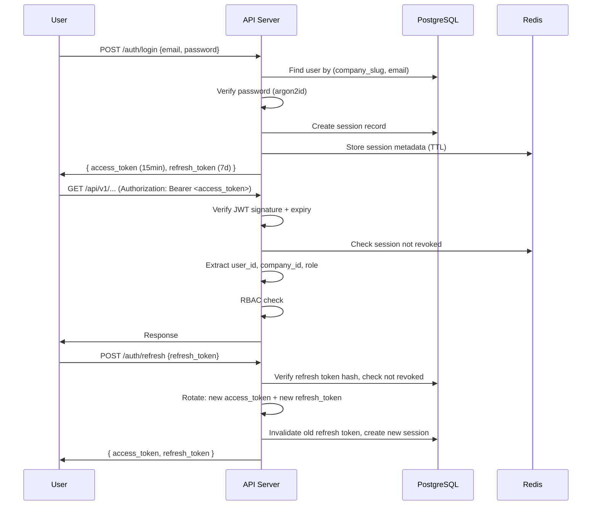

### 10.2 JWT Claims

```json
{
  "sub": "<user_id>",
  "cid": "<company_id>",
  "role": "admin",
  "tid": "<token_id>",
  "iat": 1696588200,
  "exp": 1696589100
}
```

- Signed with RS256 (asymmetric) or HS256 (symmetric, simpler for v1)
- Access token TTL: 15 minutes
- Refresh token TTL: 7 days
- Refresh token stored as argon2id hash in `sessions` table

### 10.3 API Key Authentication Flow

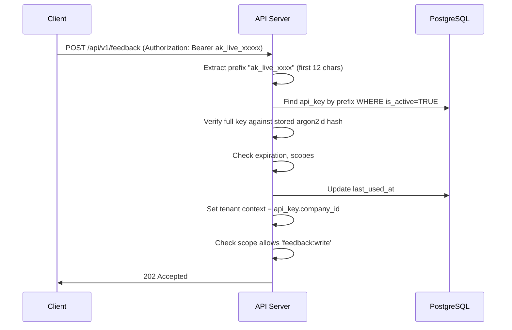

**Key format:** `ak_live_<32 random chars>` (prefix is first 12 chars for lookup)

---

## 11. Authorization / RBAC Architecture

### 11.1 System Roles

| Role | Description | Scope |
|---|---|---|
| `super_admin` | Platform operator | Cross-tenant |
| `company_admin` | Company owner/admin | Single tenant |
| `manager` | Department manager | Single tenant |
| `analyst` | Read-only analyst | Single tenant |
| `support_agent` | Support team member | Single tenant, tickets only |
| `api_service` | Programmatic access (API key) | Single tenant, scoped |

### 11.2 Permission Matrix

| Permission | super_admin | company_admin | manager | analyst | support_agent |
|---|---|---|---|---|---|
| `company:manage` | ✓ | ✓ | — | — | — |
| `users:manage` | ✓ | ✓ | — | — | — |
| `api_keys:manage` | ✓ | ✓ | — | — | — |
| `feedback:write` | ✓ | ✓ | ✓ | — | — |
| `feedback:read` | ✓ | ✓ | ✓ | ✓ | ✓ |
| `tickets:manage` | ✓ | ✓ | ✓ | — | ✓ |
| `tickets:read` | ✓ | ✓ | ✓ | ✓ | ✓ |
| `analytics:read` | ✓ | ✓ | ✓ | ✓ | — |
| `crisis:manage` | ✓ | ✓ | ✓ | — | — |
| `integrations:manage` | ✓ | ✓ | — | — | — |
| `reports:read` | ✓ | ✓ | ✓ | ✓ | — |
| `audit:read` | ✓ | ✓ | — | — | — |

### 11.3 RBAC Enforcement

```python
# Middleware chain:
Request
  → AuthMiddleware (JWT or API key)
  → TenantMiddleware (set company_id from auth)
  → RBACMiddleware (check permission against role)
  → Route handler (query with company_id filter)
```

---

## 12. Multi-Tenancy Strategy

### 12.1 Approach: Shared Database, Tenant Column

All tenants share the same PostgreSQL database. Every tenant-owned table has a `company_id` column. This is the correct choice for this SaaS tier because:

- Simpler operational overhead than schema-per-tenant
- Scales to thousands of tenants
- Single migration path
- Row-level security (RLS) as defense-in-depth

### 12.2 Tenant Context Propagation

```
Authentication
    ↓
company_id resolved from JWT/API key
    ↓
TenantContext (thread-local / contextvars)
    ↓
SQLAlchemy session events: auto-add WHERE company_id = :tenant
    ↓
Kafka message headers: tenant_id
    ↓
Redis key prefix: tenant:{company_id}:...
    ↓
S3 path prefix: s3://bucket/{company_id}/...
    ↓
Vector search filter: WHERE company_id = :tenant
```

### 12.3 Defense-in-Depth

1. **Application layer**: SQLAlchemy query filter automatically adds `company_id`
2. **Database layer**: PostgreSQL RLS policies as a safety net
3. **Kafka layer**: `company_id` in message key ensures co-partitioning
4. **Redis layer**: Key prefixed with `tenant:{company_id}:`
5. **S3 layer**: Objects stored under `/{company_id}/` prefix
6. **Test layer**: Integration tests verify cross-tenant isolation

```sql
-- PostgreSQL RLS (defense-in-depth)
ALTER TABLE feedback ENABLE ROW LEVEL SECURITY;
CREATE POLICY tenant_isolation ON feedback
    USING (company_id = current_setting('app.current_tenant')::uuid);
```

---

## 13. AI/ML Architecture

### 13.1 Model Registry

| Model | Type | Purpose | Deployment |
|---|---|---|---|
| `sentiment-v2` | Transformer (distilbert) | Sentiment classification | Inference server |
| `emotion-v1` | Transformer | Emotion detection | Inference server |
| `issue-classifier-v1` | Fine-tuned classifier | Issue/complaint categorization | Inference server |
| `intent-classifier-v1` | Fine-tuned classifier | Intent detection (request, complaint, praise) | Inference server |
| `embedding-v1` | Sentence-transformers (all-MiniLM-L6-v2) | Text embeddings (384-dim) | Inference server |
| `churn-predictor-v1` | XGBoost/LightGBM | Churn risk scoring | Inference server |

### 13.2 Inference Server Architecture

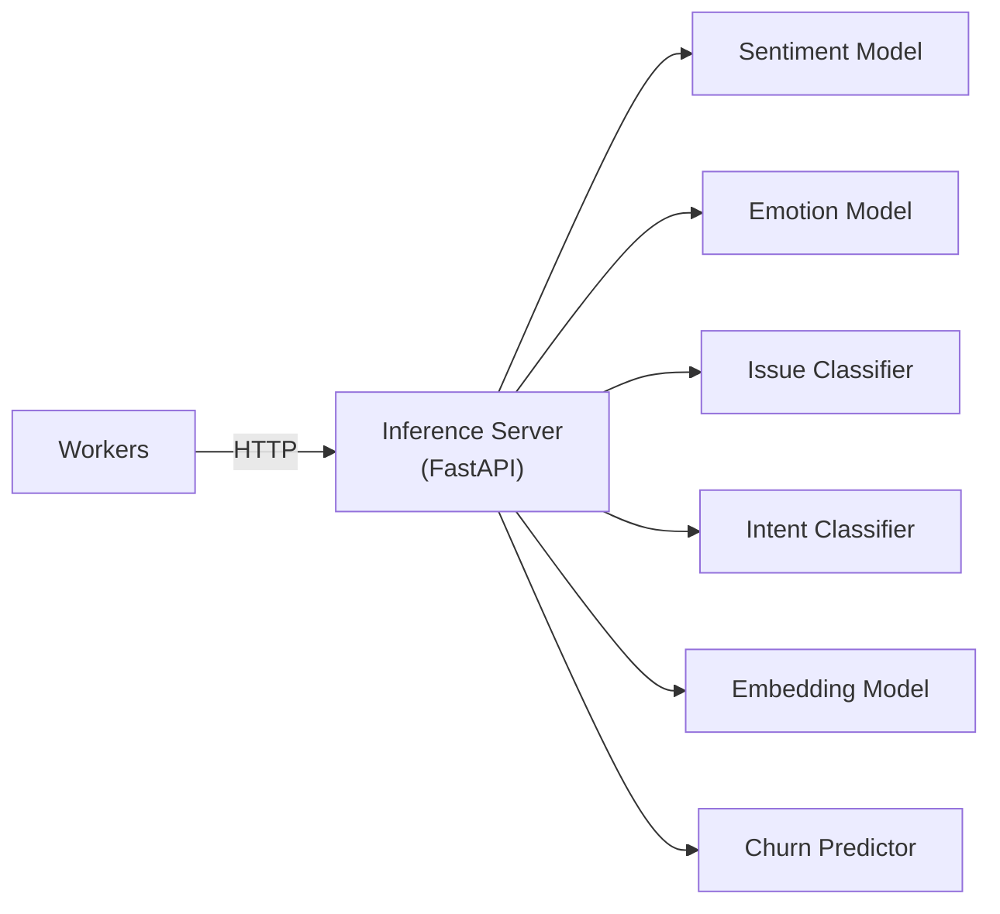

The inference server:
- Loads models at startup
- Exposes REST endpoints per model
- Supports batch inference
- Reports latency & throughput metrics
- Allows hot-swap of model versions via config

### 13.3 Model Routing Decision Matrix

| Task | Method | Rationale |
|---|---|---|
| Sentiment analysis | ML model (distilbert) | Fast, deterministic, cheap |
| Emotion detection | ML model | Fast, deterministic |
| Issue classification | ML classifier | Fast, enumerable categories |
| Intent detection | ML classifier | Fast, enumerable intents |
| Embedding | Sentence-transformer | Fast, cheap |
| Trend detection | Statistical (z-score, moving average) | No ML needed |
| Crisis scoring | Rule-based composite + thresholds | Deterministic, auditable |
| Root cause analysis | LLM (complex reasoning) | Requires cross-signal correlation |
| Business recommendation | LLM | Requires reasoning over multiple signals |
| Ticket response generation | LLM | Requires language generation |
| Churn prediction | XGBoost/LightGBM | Tabular features, fast |
| Knowledge base search | Embedding + vector search | Semantic retrieval |

---

## 14. LLM Architecture

### 14.1 LLM Gateway (Abstraction Layer)

```python
# packages/llm-gateway
class LLMGateway:
    """Provider-agnostic LLM interface"""

    providers: dict[str, LLMProvider]  # "openai", "anthropic", "local"
    default_provider: str
    fallback_provider: str

    async def complete(
        self,
        prompt: str,
        model: str,
        response_schema: type[BaseModel],  # Pydantic structured output
        max_tokens: int,
        temperature: float,
        timeout: float,
        tenant_id: str,
    ) -> LLMResponse:
        ...
```

### 14.2 Provider Interface

```python
class LLMProvider(ABC):
    @abstractmethod
    async def complete(self, request: LLMRequest) -> LLMResponse: ...

class OpenAIProvider(LLMProvider): ...
class AnthropicProvider(LLMProvider): ...
class LocalProvider(LLMProvider): ...  # vLLM, Ollama
```

### 14.3 Cost Control Strategy

1. **Tiered model routing**: Simple tasks → small model; complex tasks → capable model
2. **Semantic caching**: If similar input was recently processed, reuse result
3. **Batch processing**: Batch multiple events for a single LLM call where safe
4. **Token budgets**: Per-tenant daily/monthly token limits
5. **Result caching**: Cache LLM outputs with TTL in Redis
6. **Short-circuit**: Rules/ML handle 80% of cases; LLM handles remaining 20%

---

## 15. Guardrail Architecture

### 15.1 Input Pipeline

```
User/Event Input
    ↓
1. PII Detection & Redaction (regex + NER)
    ↓
2. Prompt Injection Detection (classifier)
    ↓
3. Input Length Validation (max tokens)
    ↓
4. Content Policy Check
    ↓
LLM Call
    ↓
5. Structured Output Validation (Pydantic)
    ↓
6. Confidence Threshold Check
    ↓
7. Business Rule Validation
    ↓
8. Tool Permission Validation (MCP)
    ↓
9. Audit Log
    ↓
Final Output
```

### 15.2 Implementation

```python
class GuardrailPipeline:
    input_guards: list[InputGuard]
    output_guards: list[OutputGuard]

    async def process(self, input: GuardrailInput) -> GuardrailOutput:
        # Run input guards
        for guard in self.input_guards:
            input = await guard.check(input)
            if input.blocked:
                return GuardrailOutput(blocked=True, reason=input.block_reason)

        # LLM call
        llm_output = await self.llm_gateway.complete(input.sanitized_prompt, ...)

        # Run output guards
        for guard in self.output_guards:
            llm_output = await guard.check(llm_output)
            if llm_output.blocked:
                return GuardrailOutput(blocked=True, reason=llm_output.block_reason)

        return GuardrailOutput(result=llm_output.parsed)
```

### 15.3 Guards

| Guard | Type | Purpose |
|---|---|---|
| `PIIRedactionGuard` | Input | Detect and redact PII before LLM |
| `PromptInjectionGuard` | Input | Detect prompt injection attempts |
| `InputLengthGuard` | Input | Enforce max token limits |
| `StructuredOutputGuard` | Output | Validate against Pydantic schema |
| `ConfidenceThresholdGuard` | Output | Reject low-confidence results |
| `BusinessRuleGuard` | Output | Validate against business policies |
| `ToolPermissionGuard` | Output | Verify tool calls are authorized |
| `HallucinationGuard` | Output | Cross-check facts against source data |

---

## 16. MCP Architecture

### 16.1 MCP Server Design

The MCP (Model Context Protocol) server provides controlled tool access for AI agents.

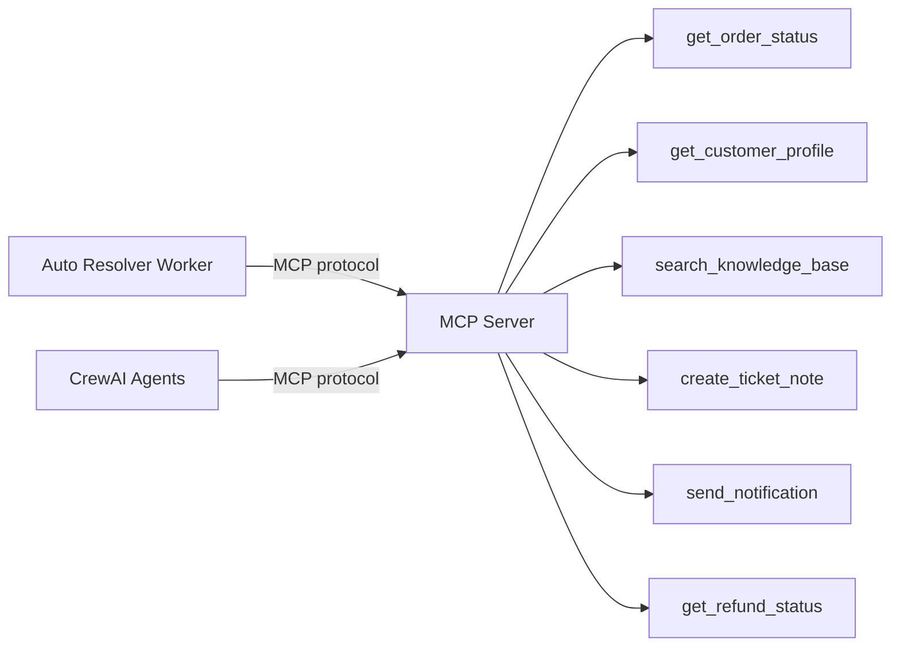

### 16.2 Tool Definitions

| Tool | Inputs | Output | Permission | Risk |
|---|---|---|---|---|
| `get_order_status` | order_id, company_id | Order details | `order:read` | Low |
| `get_customer_profile` | customer_id, company_id | Customer info (PII-safe) | `customer:read` | Low |
| `search_knowledge_base` | query, company_id, top_k | KB articles | `knowledge:read` | Low |
| `create_ticket_note` | ticket_id, note, company_id | Note created | `ticket:write` | Medium |
| `send_notification` | channel, recipient, message | Sent | `notification:write` | Medium |
| `get_refund_status` | order_id, company_id | Refund info | `refund:read` | Low |

### 16.3 Security

- Every tool call is tenant-scoped (company_id injected from context, not from LLM)
- Input validation via Pydantic
- Output filtering for PII
- Rate limiting per tenant per tool
- Audit logging of every tool invocation
- Timeout enforcement (5s default)
- No shell access, no raw SQL, no file system access

---

## 17. CrewAI Architecture

### 17.1 When to Use CrewAI

CrewAI is reserved for complex multi-step reasoning that benefits from agent collaboration. Normal deterministic processing remains in standard Kafka workers.

### 17.2 Crisis Investigation Crew

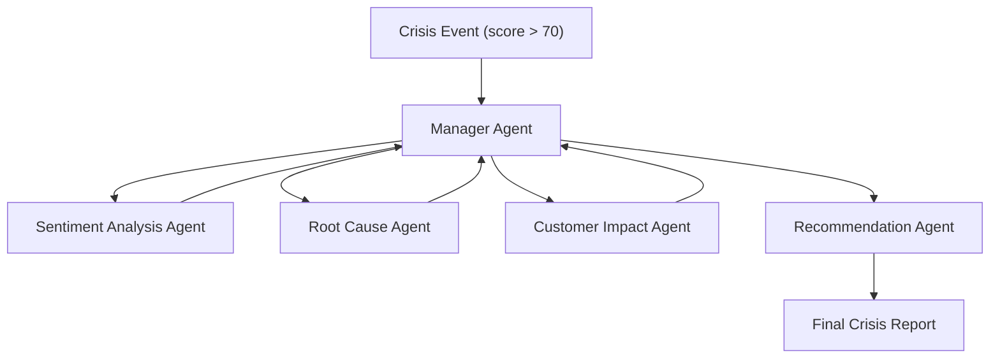

**Agents:**

| Agent | Role | Tools |
|---|---|---|
| Manager | Orchestrates investigation | None (coordinator) |
| Sentiment Analyst | Analyze sentiment patterns | `search_knowledge_base`, DB queries |
| Root Cause Investigator | Identify contributing factors | `get_order_status`, DB queries |
| Customer Impact Assessor | Quantify customer impact | `get_customer_profile`, DB queries |
| Recommendation Generator | Propose actions | All read tools |

### 17.3 Complex Ticket Resolution Crew

For tickets in the 75-95% confidence range that involve multiple systems:

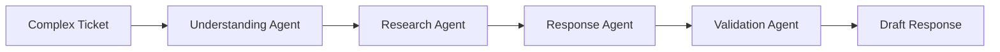

---

## 18. Redis Architecture

### 18.1 Key Schema

```
# Sessions
session:{session_id}                    → JSON (user session data), TTL 15min

# Rate Limiting
ratelimit:{company_id}:{endpoint}       → counter, TTL 1min
ratelimit:apikey:{key_prefix}           → counter, TTL 1min

# Idempotency
idempotency:{company_id}:{key}          → event_id, TTL 24h

# Semantic Cache
cache:sentiment:{company_id}:{text_hash} → JSON (cached result), TTL 1h
cache:issue:{company_id}:{text_hash}     → JSON (cached result), TTL 1h

# LLM Response Cache
llm_cache:{company_id}:{prompt_hash}    → JSON (LLM response), TTL 30min

# Frequently Accessed Analytics
analytics:{company_id}:overview          → JSON (dashboard data), TTL 5min
analytics:{company_id}:crisis            → JSON (crisis status), TTL 1min

# Deduplication
dedup:{company_id}:{content_hash}       → 1, TTL 1h

# Worker Heartbeats
worker:{worker_type}:{instance_id}      → timestamp, TTL 30s
```

### 18.2 Configuration

| Setting | Value |
|---|---|
| Max memory | 2GB (dev), 8-16GB (prod) |
| Eviction policy | `allkeys-lru` |
| Persistence | RDB snapshots every 5min (prod) |
| Max connections | 1000 |
| Databases | 0 (single database, use key prefixes) |

---

## 19. Vector Search Architecture

### 19.1 pgvector Configuration

- **Embedding model**: `all-MiniLM-L6-v2` (384 dimensions)
- **Index type**: IVFFlat (good balance of build speed and query speed)
- **Distance metric**: Cosine similarity
- **Index lists**: 100 (for ~1M vectors; tuned as data grows)

### 19.2 Use Cases

| Use Case | Query Pattern |
|---|---|
| Duplicate detection | Cosine similarity > 0.95 within same company |
| Similar complaints | Top-K similar feedback within same company |
| Semantic search | Query embedding vs stored feedback embeddings |
| Knowledge retrieval | Query embedding vs knowledge document embeddings |
| Historical incident matching | Compare new crisis signals against past crises |
| Support response retrieval | Match ticket to similar resolved tickets |

### 19.3 Tenant Isolation

```sql
-- ALWAYS filter by company_id
SELECT id, text_preview, 1 - (embedding <=> $1) AS similarity
FROM embeddings
WHERE company_id = $2
  AND source_type = $3
ORDER BY embedding <=> $1
LIMIT $4;
```

---

## 20. Security Architecture

### 20.1 Defense Layers

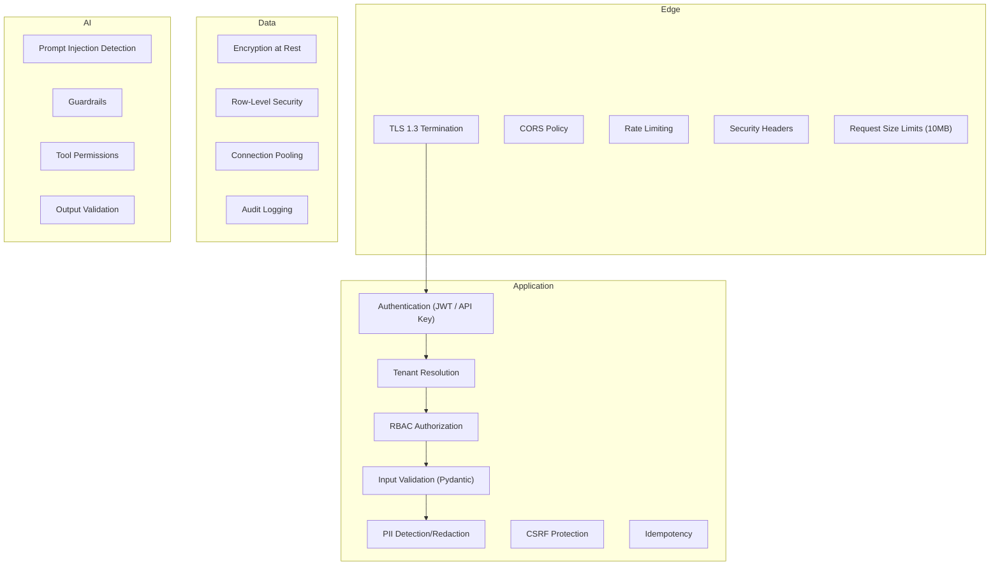

### 20.2 Security Checklist

| Area | Implementation |
|---|---|
| Password hashing | argon2id (memory=65536, iterations=3, parallelism=4) |
| JWT signing | HS256 with rotatable secret (v1); RS256 for production |
| API key hashing | argon2id |
| CORS | Whitelist frontend origin only |
| CSRF | SameSite=Strict cookies + CSRF token for browser auth |
| Rate limiting | 100 req/min per API key, 1000 req/min per tenant (configurable) |
| Request size | 10MB max (100MB for file uploads) |
| SQL injection | SQLAlchemy parameterized queries (never raw string interpolation) |
| XSS | React (auto-escapes), CSP headers |
| Secrets | Environment variables, never committed to git |
| Dependencies | `pip-audit`, `npm audit`, Trivy container scanning |
| Logging | Never log passwords, API keys, or raw PII |

---

## 21. Observability Architecture

### 21.1 Stack

| Layer | Tool | Purpose |
|---|---|---|
| Metrics | Prometheus | Time-series metrics collection |
| Dashboards | Grafana | Visualization |
| Logging | Structured JSON → stdout | Container log aggregation |
| Error tracking | Sentry | Exception tracking & alerting |
| Tracing | OpenTelemetry → Jaeger (optional) | Distributed tracing |

### 21.2 Key Metrics

| Metric | Type | Labels |
|---|---|---|
| `http_requests_total` | Counter | method, endpoint, status, tenant |
| `http_request_duration_seconds` | Histogram | method, endpoint, tenant |
| `kafka_messages_produced_total` | Counter | topic, tenant |
| `kafka_messages_consumed_total` | Counter | topic, consumer_group |
| `kafka_consumer_lag` | Gauge | topic, consumer_group, partition |
| `worker_processing_duration_seconds` | Histogram | worker_type |
| `worker_failures_total` | Counter | worker_type, error_type |
| `inference_duration_seconds` | Histogram | model |
| `llm_tokens_total` | Counter | provider, model, direction |
| `llm_cost_usd` | Counter | provider, model |
| `llm_latency_seconds` | Histogram | provider, model |
| `redis_hit_total` | Counter | key_type |
| `redis_miss_total` | Counter | key_type |
| `db_query_duration_seconds` | Histogram | query_type |
| `ticket_resolution_time_seconds` | Histogram | resolution_type |
| `active_crises` | Gauge | tenant |

### 21.3 Structured Log Format

```json
{
  "timestamp": "2026-10-06T10:30:05.123Z",
  "level": "INFO",
  "logger": "worker.sentiment",
  "message": "Sentiment analysis complete",
  "event_id": "EVT-a1b2c3d4",
  "company_id": "COMP-001",
  "correlation_id": "corr-x1y2z3",
  "request_id": "req-abc123",
  "duration_ms": 45,
  "model": "sentiment-v2",
  "result": "negative"
}
```

---

## 22. Deployment Architecture

### 22.1 Local Development (Docker Compose)

```yaml
# docker-compose.yml services:
services:
  frontend:       # Next.js dev server
  api:            # FastAPI with hot-reload
  postgres:       # PostgreSQL 16 + pgvector
  redis:          # Redis 7
  kafka:          # Kafka KRaft (single node)
  minio:          # S3-compatible storage
  worker-normalization:
  worker-sentiment:
  worker-complaint:
  worker-trend:
  worker-crisis:
  worker-rootcause:
  worker-demand:
  worker-product:
  worker-support:
  worker-churn:
  worker-recommendation:
  worker-ticket-routing:
  worker-auto-resolver:
  inference:      # ML inference server
  mcp-server:     # MCP tool server
  prometheus:     # Metrics
  grafana:        # Dashboards
```

### 22.2 Production (Kubernetes)

```
Namespace: signalstream

Deployments:
  frontend          (2 replicas, HPA)
  api               (3 replicas, HPA based on CPU/request rate)
  inference         (2 replicas, HPA based on CPU)
  mcp-server        (2 replicas)
  worker-norm       (3 replicas, scalable by Kafka lag)
  worker-sentiment  (3 replicas)
  worker-complaint  (3 replicas)
  worker-trend      (2 replicas)
  worker-crisis     (2 replicas)
  worker-rootcause  (2 replicas)
  worker-demand     (2 replicas)
  worker-product    (2 replicas)
  worker-support    (2 replicas)
  worker-churn      (2 replicas)
  worker-recommend  (2 replicas)
  worker-routing    (3 replicas)
  worker-resolver   (2 replicas)

StatefulSets:
  kafka             (3 replicas)
  postgres          (1 primary + read replica, or managed DB)
  redis             (1 primary + 1 replica, or managed)

Services:
  nginx-ingress     (LoadBalancer)

ConfigMaps + Secrets for all env vars
```

### 22.3 Production Topology

```
                    INTERNET
                       │
                       ▼
                 DNS / TLS
                       │
                       ▼
               Nginx Ingress Controller
                 /           \
                /             \
               ▼               ▼
        Frontend (Next.js)  API Cluster (FastAPI)
                                │
            ┌───────────────────┼────────────────┐
            │                   │                │
            ▼                   ▼                ▼
        PostgreSQL            Redis           Kafka
        + pgvector                              │
                                   ┌────────────┴───────────┐
                                   │                        │
                        ┌──────────┼──────────┐    ┌────────┼────────┐
                        │          │          │    │        │        │
                        ▼          ▼          ▼    ▼        ▼        ▼
                    Worker     Worker     Worker Worker  Worker   Worker
                    Norm       Sent       Comp   Trend   Crisis   Route
                        │          │          │    │        │        │
                        └──────────┼──────────┘    └────────┼────────┘
                                   │                        │
                                   ▼                        ▼
                            Inference Server          MCP Server
                                   │
                            ┌──────┼──────┐
                            │             │
                        NLP Models    Embedding
                                      Models

                    Prometheus + Grafana + Sentry
                    (observes every component)
```

---

## 23. CI/CD Architecture

### 23.1 GitHub Actions Pipeline

```mermaid
graph LR
    PUSH["Git Push"] --> LINT["Lint & Format"]
    LINT --> TYPE["Type Check"]
    TYPE --> UNIT["Unit Tests"]
    UNIT --> INT["Integration Tests"]
    INT --> SEC["Security Scan<br/>(pip-audit, npm audit, Trivy)"]
    SEC --> BUILD["Docker Build"]
    BUILD --> CSCAN["Container Scan"]
    CSCAN --> PUSH_IMG["Push Image to Registry"]
    PUSH_IMG --> STAGE["Deploy Staging"]
    STAGE --> SMOKE["Smoke Tests"]
    SMOKE --> PROD["Production Deploy<br/>(manual approval)"]
```

### 23.2 Workflows

| Workflow | Trigger | Steps |
|---|---|---|
| `ci.yml` | Push to any branch | Lint, type check, unit tests, integration tests |
| `security.yml` | Push to main, weekly cron | pip-audit, npm audit, Trivy |
| `build.yml` | Push to main | Docker build + push |
| `deploy-staging.yml` | Push to main (auto) | Deploy to staging K8s |
| `deploy-prod.yml` | Manual trigger | Deploy to production K8s |

---

## 24. Testing Strategy

### 24.1 Test Pyramid

| Layer | Coverage Target | Tools |
|---|---|---|
| Unit tests | 80% (core), 60% (workers) | pytest, Jest |
| Integration tests | All API endpoints, Kafka flows | pytest, testcontainers |
| API tests | All endpoints | httpx, pytest |
| Kafka tests | All topic flows | testcontainers-kafka |
| Database tests | Migrations, queries, RLS | pytest, testcontainers-postgres |
| Redis tests | Caching, rate limiting | pytest, fakeredis |
| Multi-tenancy tests | Cross-tenant isolation | pytest |
| ML tests | Model accuracy, latency | pytest |
| LLM tests | Output schema validation | pytest |
| Security tests | Auth, RBAC, injection | pytest |
| Load tests | Throughput, latency | Locust |
| E2E tests | Critical user flows | Playwright |

### 24.2 Critical Tenant Isolation Tests

```python
def test_company_a_cannot_access_company_b_feedback():
    """Company A's JWT must not retrieve Company B's data"""

def test_api_key_company_a_cannot_ingest_to_company_b():
    """API key scoped to Company A must be rejected for Company B"""

def test_vector_search_tenant_isolation():
    """Vector search must never return another tenant's embeddings"""

def test_kafka_events_carry_correct_tenant_id():
    """Events produced for Company A must have company_id = A"""

def test_redis_cache_tenant_isolation():
    """Cached analytics for Company A must not leak to Company B"""
```

---

## 25. Disaster Recovery Strategy

| Component | Strategy | RPO | RTO |
|---|---|---|---|
| PostgreSQL | Automated daily backups + WAL streaming | 1 hour | 4 hours |
| Redis | RDB snapshots (non-critical cache) | N/A | Minutes (cold start) |
| Kafka | Replication factor 3, min ISR 2 | 0 (replicated) | Minutes (broker failover) |
| S3/MinIO | Object versioning + cross-region replication | 0 | Minutes |
| Application | Stateless, redeploy from images | N/A | Minutes |
| Secrets | Backed up in encrypted vault | N/A | Minutes |

---

## 26. Backup Strategy

| Data | Method | Frequency | Retention |
|---|---|---|---|
| PostgreSQL | `pg_dump` + WAL archiving | Daily full + continuous WAL | 30 days |
| Configuration | Git (infrastructure-as-code) | Every commit | Indefinite |
| Kafka topics | Mirror Maker 2 (prod) | Continuous | Per topic retention |
| S3 objects | Versioning + lifecycle rules | Continuous | Per policy |
| Secrets | Encrypted backup to separate vault | On change | Indefinite |

---

## 27. Scaling Strategy

### 27.1 Horizontal Scaling

| Component | Scaling Trigger | Method |
|---|---|---|
| API servers | CPU > 70%, request rate | HPA (Kubernetes) |
| Workers | Kafka consumer lag > threshold | KEDA or custom HPA |
| Inference server | CPU > 80%, queue depth | HPA |
| Frontend | CPU > 70% | HPA |

### 27.2 Database Scaling

| Stage | Strategy |
|---|---|
| Current | Single primary (sufficient for early scale) |
| Growth | Read replicas for analytics queries |
| Scale | Table partitioning (feedback by month) |
| Large scale | Citus or tenant-based sharding |

### 27.3 Kafka Scaling

- Add partitions to increase parallelism
- Add brokers to distribute load
- Increase consumer instances (up to partition count)

---

## 28. Cost Optimization Strategy

| Area | Strategy |
|---|---|
| LLM costs | Semantic caching, model routing (small → large), token budgets |
| Compute | HPA scales down during low traffic |
| Storage | Tiered retention, compress old data |
| Database | Connection pooling (PgBouncer), query optimization |
| Kafka | Compression (lz4), appropriate retention |
| Redis | LRU eviction, appropriate TTLs |
| Models | Small models (distilbert) for simple tasks |
| Batch | Batch inference where latency allows |

---

## 29. Development Phases

| Phase | Scope | Dependencies |
|---|---|---|
| **Phase 1** | Architecture + documentation | None |
| **Phase 2** | Repository structure + infrastructure configs | Phase 1 |
| **Phase 3** | Database schema + migrations | Phase 2 |
| **Phase 4** | Authentication + RBAC + multi-tenancy | Phase 3 |
| **Phase 5** | API + API key ingestion | Phase 4 |
| **Phase 6** | Normalization pipeline | Phase 5 |
| **Phase 7** | Kafka setup + topic creation | Phase 2 |
| **Phase 8** | Workers (sentiment, complaint, trend, crisis, etc.) | Phase 6, 7 |
| **Phase 9** | ML inference server | Phase 2 |
| **Phase 10** | LLM gateway + guardrails | Phase 8, 9 |
| **Phase 11** | MCP server | Phase 10 |
| **Phase 12** | JEV routing | Phase 8 |
| **Phase 13** | Auto resolver | Phase 11, 12 |
| **Phase 14** | CrewAI workflows | Phase 10, 11 |
| **Phase 15** | Frontend dashboards | Phase 5 (API ready) |
| **Phase 16** | External integrations | Phase 5 |
| **Phase 17** | Observability (Prometheus, Grafana) | Phase 2 |
| **Phase 18** | Testing suite | All previous phases |
| **Phase 19** | Dockerfiles | All services |
| **Phase 20** | Kubernetes manifests | Phase 19 |
| **Phase 21** | CI/CD pipelines | Phase 20 |
| **Phase 22** | Production deployment docs | Phase 21 |
| **Phase 23** | Load testing | Phase 22 |
| **Phase 24** | Security testing | Phase 22 |
| **Phase 25** | Final hardening | Phase 23, 24 |

---

## 30. Production Deployment Plan

### 30.1 Pre-Deployment Checklist

- [ ] All tests pass (unit, integration, security, tenant isolation)
- [ ] Container images built and scanned
- [ ] Secrets configured in production vault
- [ ] Database migrations tested against production-like data
- [ ] Kafka topics created with correct replication
- [ ] DNS configured
- [ ] TLS certificates provisioned
- [ ] Monitoring dashboards configured
- [ ] Alerting rules configured
- [ ] Backup procedures tested
- [ ] Runbook reviewed

### 30.2 Deployment Order

1. **Infrastructure**: PostgreSQL, Redis, Kafka, MinIO, Monitoring
2. **API Gateway**: Nginx ingress with TLS
3. **API Server**: Deploy, run migrations, verify health
4. **Inference Server**: Deploy, verify model loading
5. **MCP Server**: Deploy, verify tool availability
6. **Workers**: Deploy one-by-one, verify consumer group registration
7. **Frontend**: Deploy, verify connectivity to API
8. **Smoke Tests**: Run automated smoke tests
9. **Seed Data**: Create demo tenants if needed
10. **Traffic**: Enable DNS/traffic routing

### 30.3 Rollback Plan

- All deployments are versioned (container tags)
- Rollback = redeploy previous image tag
- Database migrations must be backward-compatible (expand-then-contract)
- Kafka schema changes must be backward-compatible (additive only)

---

## 31. Internal Consistency Checks

### 31.1 Verified Consistency

| Check | Status |
|---|---|
| Worker dependency graph matches topic subscriptions | ✓ |
| Consumer groups match worker count | ✓ |
| All tenant-owned tables have `company_id` | ✓ |
| All API endpoints require authentication | ✓ |
| All Kafka events include `company_id` | ✓ |
| Redis keys include tenant prefix | ✓ |
| Vector search always filters by `company_id` | ✓ |
| LLM is only used where reasoning is needed | ✓ |
| Simple tasks use ML/rules, not LLM | ✓ |
| Guardrails cover input and output | ✓ |
| MCP tools are tenant-scoped and audited | ✓ |
| CrewAI is used only for complex multi-agent tasks | ✓ |
| DLQ exists for all worker pipelines | ✓ |
| Health endpoints on all services | ✓ |
| RBAC permissions cover all endpoints | ✓ |

### 31.2 Identified Trade-offs

| Decision | Trade-off | Rationale |
|---|---|---|
| Shared DB (not schema-per-tenant) | Simpler ops, needs careful RLS | Scales to 1000s of tenants, single migration path |
| LLM Gateway as library (not service) | Tighter coupling | Avoids extra network hop; abstraction supports future extraction |
| KRaft (no ZooKeeper) | Newer, less battle-tested | Simpler deployment, Kafka 3.7 KRaft is stable |
| pgvector (not dedicated vector DB) | Lower scale ceiling | Simpler ops, sufficient for millions of vectors |
| HS256 JWT (v1) | Shared secret | Simpler for single API service; switch to RS256 when needed |

---

> [!TIP]
> This plan is internally consistent and ready for implementation. Phase 2 (Repository Structure + Infrastructure) can begin immediately.
